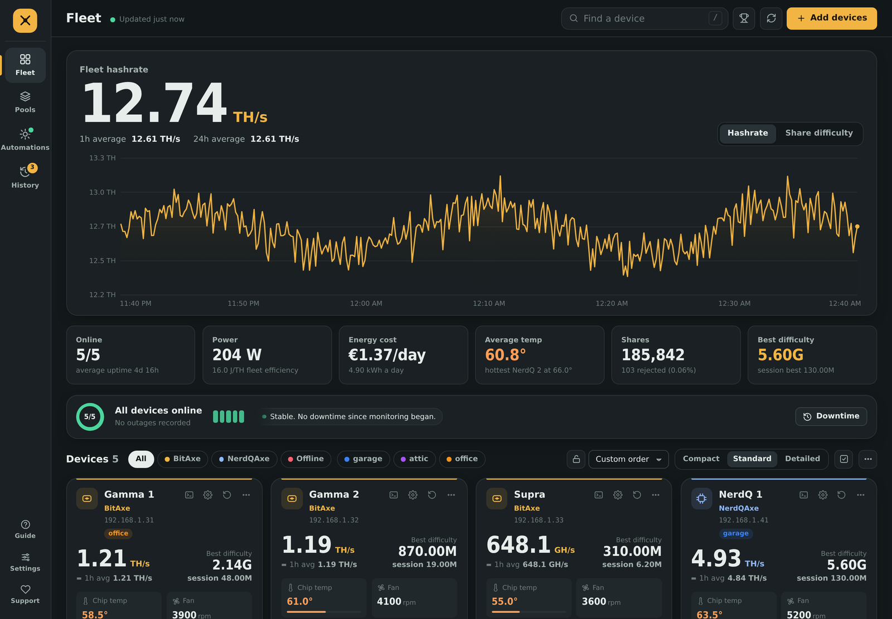
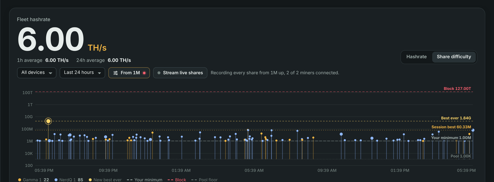
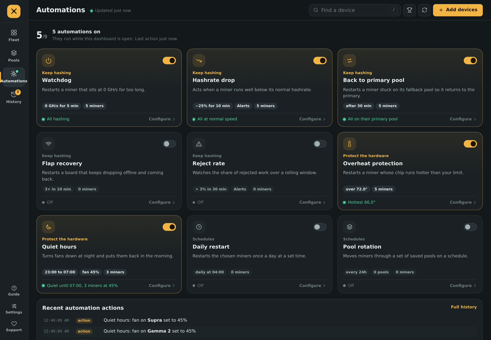
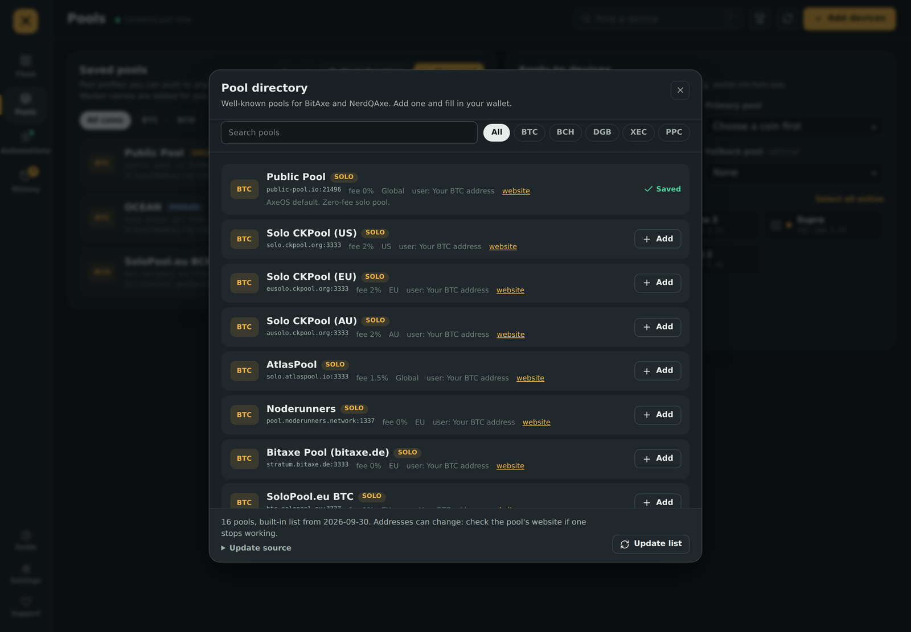
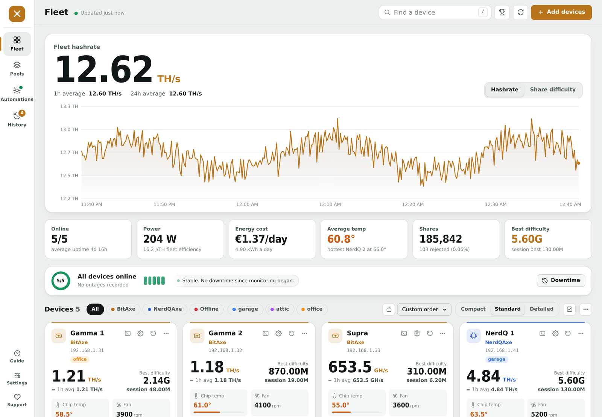
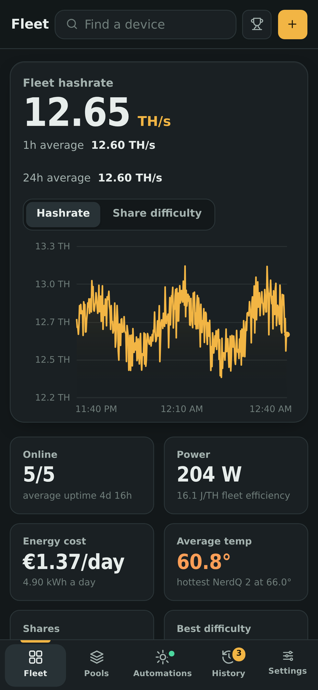
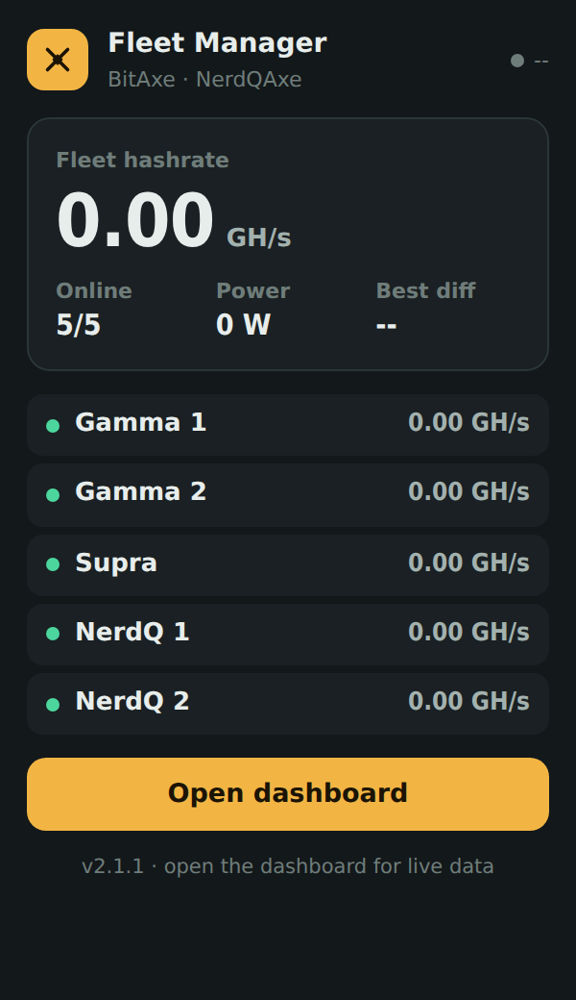

# ⛏ AxeOS Fleet Manager

**Manage and monitor your entire BitAxe & NerdQAxe SHA-256 mining fleet from one Chrome extension.**

Scan your local network, watch hashrate and difficulty in real time, stream live device logs, catch the moment you solve a block, switch pools across multiple devices at once, and automate routine maintenance - all without opening a single device web page.

   

| Share difficulty | Automations |
|---|---|
|  |  |
| **Pool directory** | **Daylight theme** |
|  |  |

&nbsp;&nbsp;&nbsp;

---

## What's new in 2.x

Version 2 is a complete redesign: a new app layout with Fleet, Pools, Automations and History sections, four themes, desktop alerts, energy cost, bulk actions and full backups. 2.1 adds a ready-made **pool directory**, new automations (eleven in total since 2.2) and a rebuilt **share difficulty chart** that shows the real difficulty of every record share instead of an average. It also fixes a 1.x bug that could wipe your device list when the extension was updated.

Release notes: [v2.3.0](RELEASE_v2_3_0.md) · [v2.2.0](RELEASE_v2_2_0.md) · [v2.1.1](RELEASE_v2_1_1.md) · full history in the [CHANGELOG](CHANGELOG.md).

---

## Why?

Running more than one BitAxe or NerdQAxe quickly becomes tedious - each device has its own web page, its own login session, and its own settings. Changing a pool on five miners means five tabs, five forms, five restarts.

AxeOS Fleet Manager pulls every device into a single dashboard. One place to see everything, one place to change everything.

---

## Features

### Monitoring
- **Auto-discovery** - scan your subnet to find every device, or add them by IP
- **Fleet view** - big fleet-hashrate readout with 1h / 24h averages and a tabbed Hashrate / Share difficulty chart with hover details, block markers and offline marks
- **Stat tiles** - online count and uptime, power and fleet efficiency (J/TH), daily energy cost, average and hottest temperature, shares and reject rate, best difficulty
- **Health strip** - online ring, one segment per device, and a ticker of recent outages
- **Device cards in three densities** - Compact rows for big fleets, Standard cards, or Detailed cards with a one-hour sparkline, power and efficiency
- **Live logs** - stream any device's log in real time, with filter, pause, save to file and colour-coded lines
- **Share difficulty chart** - every share that beats a session best, at its exact difficulty, on a log scale with pool, best-ever and block lines; set a minimum difficulty and optionally record every share above it
- **Live share difficulty** - watch every share a device submits the moment it lands
- **Desktop alerts** - device offline or back, block found, automation restarts (while the dashboard is in the background)
- **Toolbar badge** - online count, or offline count in red

### Block detection
- **Catch your blocks** - a celebration with the device, coin, pool and the **actual difficulty your miner reached**
- **Block history** - every block kept in History, with an unseen counter on the trophy and markers on the hashrate chart

### Control
- **Pool directory** - a ready-made, updatable list of well-known solo and pooled pools for BTC, BCH, DGB, XEC and PPC; add one and fill in your wallet
- **Pool manager** - save pool profiles per coin, tagged Solo or Pooled, and apply them to many devices at once, with per-device progress; see how many miners are on each pool right now
- **Smart URL parsing** - paste `stratum+tcp://host:port` and host and port are split for you
- **Worker suffixes** - the device name is appended to your wallet automatically (`wallet.devicename`)
- **Separate fallback coin** - the backup pool can mine a different coin
- **Bulk actions** - select several devices to apply a pool, restart or remove them together
- **Per-device settings** - fan, frequency, voltage, primary and fallback pool

### Automations
- **Watchdog** - restart a device stuck at 0 GH/s past a timeout
- **Hashrate drop** - restart or alert when a miner runs well below its normal hashrate
- **Shares stalled** - restart a miner that keeps hashing but stops sending shares
- **Back to primary pool** - restart a miner stuck on its fallback pool
- **Flap recovery** - restart a board that keeps dropping offline and coming back
- **Reject rate** - alert or restart when too many shares are rejected
- **Overheat protection** - restart a device above a temperature limit, with a cooldown so it can't loop
- **Heat slowdown** - lower frequency, then voltage, when the chip or the voltage regulator runs too hot, instead of looping through the firmware's thermal cut-off; original settings restorable
- **Quiet hours** - lower fans at night and restore them in the morning, with a heat safety limit
- **Daily restart** - restart chosen miners once a day at a set time
- **Pool rotation** - move devices through two or more pools on a schedule
- Every action is logged, and settings save as you change them

### Organization and comfort
- **Search** (press `/`), type / offline / label filters, sorting by hashrate, difficulty, temperature, efficiency, uptime, name or IP, plus drag-and-drop custom order with a lock
- **Labels and icons** - two coloured labels and one of ten icons per device
- **Four themes** - Circuit (default), Daylight (light), Neon Vault, Aurora
- **Text size**, **°C / °F**, **refresh interval** from 5 s to 1 min
- **Full backup and restore**, plus separate device and pool import / export
- **Keyboard shortcuts** and a built-in guide

---

## Installation

1. Download the latest `axe-fleet-manager-vX.X.X.zip` from the [Releases](../../releases) page and unzip it. Its SHA-256 checksum is listed in the release notes.
2. Open `chrome://extensions` in Chrome (or any Chromium browser).
3. Enable **Developer mode** (toggle, top-right).
4. Click **Load unpacked** and select the unzipped folder.
5. Click the extension icon, open the dashboard, and follow the setup tour.

### Updating

Chrome keeps an unpacked extension's data per folder. To keep your devices, pools and settings:

1. Replace the files **inside the folder you originally loaded** with the new ones.
2. Go to `chrome://extensions` and press the reload button on AxeOS Fleet Manager.

Loading the new version from a *different* folder installs a second copy with empty storage. If you do that, export first: in v1.6.4 and later use the device and pool export buttons (v2 also has a full backup in Settings), then import in the new copy.

Coming from 1.x: Chrome asks you to re-enable the extension once, because v2 adds the `notifications` permission. Version 2 requires Chrome 116 or later.

> Requires devices running AxeOS / ESP-Miner firmware reachable on your local network.

---

## Getting Started

When you first open the dashboard, a short tour walks you through finding your devices. Keep the dashboard tab open (pinned is ideal): charts, alerts and automations run from it.

**Finding your subnet:** your subnet is the first three parts of a device's IP address.
- **Windows** - open Command Prompt, type `ipconfig`, look at the IPv4 Address.
- **macOS** - System Settings → Network → look for your IP Address.
- If a device is at `192.168.1.42`, your subnet is `192.168.1`.

Enter that, scan, and your devices appear. Rename them, tag them, and you're ready to manage pools and automations.

---

## How It Works

AxeOS devices protect write operations (changing pools, restarting) with a session cookie to prevent CSRF attacks. A browser extension runs on its own origin and can't send that cookie cross-site, which is why naive approaches return `401 Unauthorized`.

AxeOS Fleet Manager solves this by briefly opening the device's own page in a background tab and running the request from inside that page's context - same-origin, with the session cookie attached automatically. The tab opens and closes in a flash; you just see the action succeed. Read-only monitoring uses ordinary direct requests.

The same technique powers live streaming: an insecure `ws://` WebSocket can't be opened from the extension's secure origin, so live logs and live difficulty run the WebSocket inside the device's own page and relay each line back to the dashboard - exactly how the device's own web UI streams its logs.

The extension is built on **Manifest V3** with a service worker for network scanning and reads, and all write and streaming actions routed through the tab-injection mechanism. No external runtime dependencies.

**Share difficulty:** AxeOS doesn't report individual shares, but it does report each miner's session best. When that value rises between two refreshes, a share of exactly that difficulty was just found; the chart records those at their real value on a log scale. For every share, stream a single miner live.

---

## Supported Devices

- **BitAxe** (all AxeOS models, including the newer Supra)
- **NerdQAxe / NerdQAxe++**

> Notes: NerdQAxe firmware has deprecated automatic fan control, so the extension exposes manual fan speed only for those devices. BitAxe firmware does not expose a 24-hour hashrate average, and the newer Supra firmware also drops the 1h/10m/1m averages; the dashboard computes a rolling local average for these devices, populated from its own sample buffer over the first hour.

---

## Privacy

Everything runs locally and all settings stay in your browser's local storage. No accounts, no telemetry, no ads. The extension makes only these network requests:

- **Your miners** on your LAN, to read their status and send the changes you make.
- **Google Fonts**, to load the Archivo typeface (the dashboard falls back to system fonts without it).
- **Your pool directory source**, only if you set one: the JSON file is downloaded once a day and when you press Update list. Nothing is sent to it.

When **Record every share** is on, your miners' own pages open in a minimized browser window so their logs can be read; that traffic also stays on your LAN.

---

## Support Development

If this tool saves you time, donations are welcome via **Support** in the dashboard's side rail:

- **BTC** · **BCH** · **DGB** · **LTC**

Each address has a one-click copy button in the app.

---

## Documentation

- [CHANGELOG](CHANGELOG.md) - full version history
- [Release notes v2.3.0](RELEASE_v2_3_0.md) - Heat slowdown on chip temperature, share minimum and share recording
- [Release notes v2.2.0](RELEASE_v2_2_0.md) - Shares stalled and VR overheat automations
- [RELEASING](docs/RELEASING.md) - how a new version is built and published
- [Release notes v2.1.1](RELEASE_v2_1_1.md) - everything new since 1.x
- [FEATURES](FEATURES.md) - complete feature and architecture reference
- In-app Guide - **Guide** in the side rail, or press `?`

---

*AxeOS Fleet Manager is an independent, open-source tool and is not affiliated with the BitAxe or NerdQAxe projects.*
